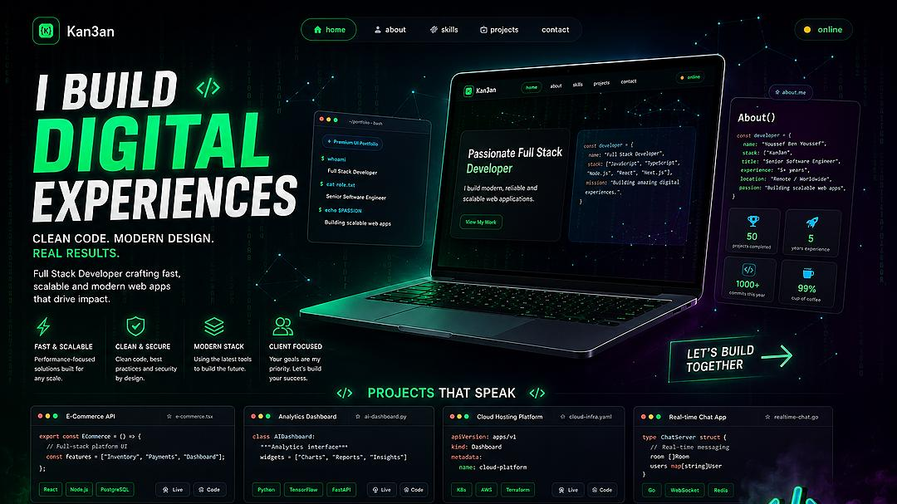

# Roshan Jha — Data Science & AI Portfolio

A responsive, dark-themed professional portfolio built with Python and Streamlit.

## Run locally

```bash
python -m venv .venv
# Windows: .venv\Scripts\activate
# macOS/Linux: source .venv/bin/activate
pip install -r requirements.txt
streamlit run app.py
```

## Deploy to Render

1. Create a GitHub repository and upload the contents of this folder.
2. Sign in to [Render](https://render.com/) and choose **New + → Blueprint**.
3. Connect the GitHub repository containing `render.yaml`.
4. Render detects the Blueprint and creates the web service. Confirm the settings and deploy.
5. When deployment finishes, open the `onrender.com` URL.

If creating a Web Service manually, use:
- **Runtime:** Python
- **Build command:** `pip install -r requirements.txt`
- **Start command:** `streamlit run app.py --server.port $PORT --server.address 0.0.0.0`

- Local URL: http://localhost:8501
- Network URL: http://10.0.0.180:8501
- External URL: http://172.210.53.192:8501

## Personalize before publishing

- The portfolio content is based on the supplied resume.
- Replace each project's generic project reference with its exact GitHub repository URL if you want project-specific buttons.
- Review all dates, institution names, and achievement claims before publishing.
- The resume PDF is bundled under `assets/` and is downloadable from the site.

## Structure

```text
roshan_portfolio/
├── app.py
├── requirements.txt
├── render.yaml
├── README.md
├── .gitignore
└── assets/
    └── Roshan_Jha_Resume.pdf
```

# Next Version :- 

1. Interactive advisor preview

2. Spam detection demonstration

3. Loan prediction demonstration

4. Project architecture sections

5. Animated visual effects

6. Mobile-responsive layout

7. Resume download

8. Render deployment configuration

- Run locally first
- pip install -r requirements.txt
- streamlit run app.py


